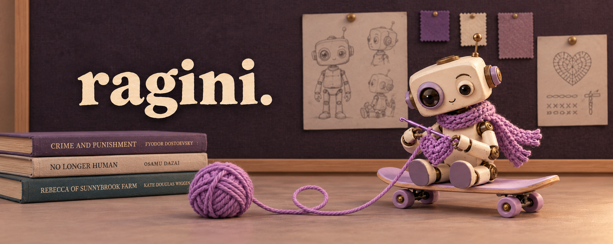

**ROBOTICS & EMBEDDED SYSTEMS ENGINEER**

Making things sense, move, and occasionally cooperate.

[LinkedIn ↗](https://www.linkedin.com/in/ragini-mishra-robotics/) · [Email ↗](mailto:ragmishra108@gmail.com)

---

## 🦾 The engineering side

I’m Ragini—a mechatronics engineer pursuing an **M.Sc. in
Autonomous Systems at Hochschule Bonn-Rhein-Sieg**.

I like working where software touches the physical world:
robot perception, manipulation, embedded electronics and
the integrations that hold everything together.

| On the workbench | What I’ve worked on |
| :--- | :--- |
| 🐾 **A robot with a sense of touch** | Tactile sensor integration for 3D object detection on Unitree Go1 |
| 🗣️ **Words into actions** | Verbal object retrieval with Toyota HSR |
| 📡 **Small boards, real hardware** | ESP32-based RFID devices and PCB prototyping |
| ⚙️ **Software that keeps things moving** | Business Central development and system integrations at Fruchthansa |

## 🔎 Open notebooks

### [Point Cloud & Laser Scan Fusion ↗](https://github.com/ragini9m/ws21-point-cloud-laser-fusion)
Exploring point-cloud projection, filtering and laser-scan fusion in ROS.

### [2D & 3D Few-Shot Object Detection ↗](https://github.com/ragini9m/Comparing-2D-FSOD-to-3D-FSOD)
Exploring detection approaches for learning from fewer examples.

## 🧰 Within reach

| Code | Hardware | Tools |
| :--- | :--- | :--- |
| Python · C++ · AL | ESP32 · Arduino · RFID | Git · Linux · Docker |
| ROS | PCB design | SolidWorks · RobotStudio |

## 🏁 A few milestones

- **Marso AI Pick & Place Challenge** — winning team
- **ifm hackathons** — two-time winner
- **BonnNetz Hackathon** — winning team
- **ICRA 2024** — RAS IDEA Grant recipient
- **ROSCon 2023** — Diversity Scholar
- **@Home Robotics Team** — Team Lead, 2021–2023

---

## 🛹 The human side

Crochet projects. Skateboard practice. A growing pile of books.

I alternate between science fiction about robots taking over
the world and classics about humans making a mess of it themselves.

🧶 Pull this thread

 

Crochet and robotics both involve following a pattern,
finding out something went wrong several steps ago,
and deciding how much to undo.

One is significantly quieter.

 

**Have a robot that needs eyes, sensors, or a little persuasion?**

I’m interested in robotics engineering opportunities involving
perception, manipulation and embedded systems.

[Let’s talk ↗](mailto:ragmishra108@gmail.com)

 

🦾 &nbsp; + &nbsp; 🧶 &nbsp; + &nbsp; 🛹 &nbsp; + &nbsp; 📚

